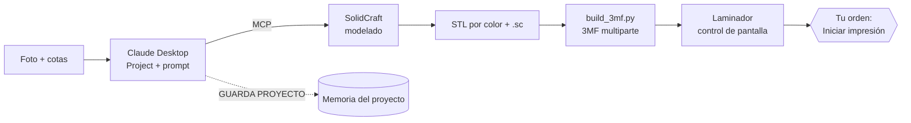

<div align="center">

# solidcraft-claude-kit

**Agente de diseño 3D con Claude: de una foto a una pieza multicolor laminada, sin tocar el CAD.**

[](https://github.com/anghdezl/solidcraft-claude-kit/actions/workflows/ci.yml)
[](https://github.com/anghdezl/solidcraft-claude-kit/releases)
[](LICENSE)
[](COMMERCIAL.md)
[](https://github.com/anghdezl/solidcraft-claude-kit/commits/main)
[](https://github.com/anghdezl/solidcraft-claude-kit/stargazers)
[](https://github.com/anghdezl/solidcraft-claude-kit/issues)


[Cómo funciona](#cómo-funciona) · [Instalación](#instalación-10-15-minutos) · [FAQ](#preguntas-frecuentes) · [Seguridad](#seguridad-léelo) · [Hoja de ruta](#hoja-de-ruta) · [Licencia](#licencia)

</div>

> **Estado: v0.1.0, fase de pruebas.** Sale de un proyecto real (Anycubic Kobra S1 + ACE y Anycubic Slicer Next), pero la instalación en otros PC aún no está validada. Lo no probado está marcado como tal. Mira [qué NO está verificado](#qué-no-está-verificado).

## Qué es
Un **Project de Claude** con instrucciones (`PROMPT_PRINCIPAL.md`) más un **kit local** (instalador, lanzadores y scripts) que convierten a Claude en un agente de diseño 3D:

1. Le mandas una **foto** de la pieza y alguna cota.
2. Te hace **hasta 3 preguntas** cerradas.
3. Modela en **[SolidCraft](https://github.com/tangency-labs/solidcraft)** (CAD paramétrico) a través de su servidor MCP, en una ventana que ves en directo.
4. Exporta `.sc`, STL por color y un **3MF multicolor**, ordenados en `salida\<pieza>\` con versión.
5. Abre tu **laminador** con control de pantalla, comprueba filamento por parte, lamina… y **se detiene antes de imprimir**. La orden de imprimir es tuya.
6. Recuerda el proyecto entre conversaciones (`GUARDA PROYECTO`): ajustes confirmados, piezas, filamentos.

No es un agente autónomo aparte: es Claude Desktop en tu PC con las instrucciones y las herramientas adecuadas.

## Cómo funciona


## Requisitos
| Requisito | Quién lo pone |
|---|---|
| Windows 10/11 (con `winget`, incluido en las versiones actualizadas) | Tú |
| App de escritorio de **Claude** instalada y con sesión iniciada ([claude.ai/download](https://claude.ai/download)) | Tú (el instalador no la instala) |
| Python 3.8+ | El instalador, con tu confirmación (`winget install Python.Python.3.12`) |
| [SolidCraft](https://github.com/tangency-labs/solidcraft) (probado 0.27.1) | El instalador, con tu confirmación (`winget install bherbruck.SolidCraft`, o el MSI si no hay winget). No está firmado: SmartScreen > "Más información" > "Ejecutar de todos modos" |
| Bloque `solidcraft` en la configuración de Claude Desktop | El instalador, con copia de seguridad y solo tras tu confirmación |
| Laminador + impresora (probado: Anycubic Slicer Next 2.0.0.3, Kobra S1, ACE) | Tú (descarga del fabricante) |
| Un **proyecto** de Claude con el prompt pegado y la conversación abierta **en la app de escritorio de este PC** | Tú: es lo que da a Claude el control de ficheros, SolidCraft y pantalla |
| Git (opcional) | Solo para clonar el repo |

El kit solo registra un servidor MCP: `solidcraft` (viene en `solidcraft-cli`). En el PC de origen Claude Desktop tiene además un servidor `Filesystem` activo; no se ha comprobado si el flujo lo necesita (el acceso a ficheros y shell funcionó con la carpeta conectada). Si tu app pide activar el control del ordenador o conceder acceso a una carpeta, acéptalo: esos avisos no se pueden automatizar y cómo se activan en tu versión no está verificado aquí.

## Uso rápido: "carga este repo"
Si ya tienes la app de escritorio de Claude y la conversación enlazada a tu PC, basta con escribir:

> Carga este repo y prepáralo todo: https://github.com/anghdezl/solidcraft-claude-kit

Claude lee `LEEME_CLAUDE.md` y `PROMPT_PRINCIPAL.md`, trae el kit a tu carpeta conectada y te pide **una sola cosa que solo puedes hacer tú**: doble clic en `instalar_todo.bat` (instala Python/SolidCraft si faltan, registra el servidor en Claude Desktop y autoriza los scripts). Después reinicias Claude Desktop y sigues. Para que las instrucciones persistan entre conversaciones, pega el prompt en un proyecto (pasos abajo).
Solo carga repos oficiales: un fork puede contener instrucciones que no son tuyas.

## Instalación (10-15 minutos)
1. Instala Claude Desktop e inicia sesión. Clona o descarga este repo.
2. **Doble clic en `instalar_todo.bat`.** El asistente (te pregunta antes de cada cambio):
   1. Comprueba Python; si falta, ofrece instalarlo con winget (después cierra la ventana y repite el doble clic).
   2. Te pide la **carpeta de trabajo** (por defecto `C:\Users\TU_USUARIO\ClaudeSolidCraft`) y copia `solidcraft\`, `docs\` y el prompt. Esa carpeta es la que conectarás a Claude.
   3. Diagnóstico; si falta SolidCraft, lo instala.
   4. Muestra el cambio que haría en `claude_desktop_config.json` (**simulación**), y solo si aceptas lo aplica: exige Claude Desktop cerrado del todo (también en la bandeja), guarda una copia `.bak-FECHA` y conserva el resto de tu configuración.
   5. Autorización de los scripts del demonio (verás el hash y escribes SI).
   Deja el log en `solidcraft\sistema\logs\instalar_entorno.log`.
3. **Reinicia Claude Desktop** del todo.
4. En Claude, crea un **proyecto**, abre `PROMPT_PRINCIPAL.md`, copia desde la línea `---` hasta el final y pégalo en *Instrucciones del proyecto* (cambia `<CARPETA_TRABAJO>`).
5. Abre una conversación **dentro del proyecto, en la app de escritorio**, conecta la carpeta de trabajo, haz doble clic en `solidcraft\lanzar_todo.bat` y escribe: *"Empieza el arranque inicial"*.
6. Claude te hará hasta 3 preguntas y una prueba mínima (caja 40×30×20 → 24000 mm³ y un STL exportado).

Comandos útiles después: `solidcraft\instalar_entorno.bat diagnostico` (solo lee), `... configurar` (simulación) y `... configurar --aplicar`.

## Qué toca el instalador fuera de la carpeta de trabajo
| Dónde | Qué | Cómo deshacerlo |
|---|---|---|
| `%LOCALAPPDATA%\Packages\Claude_*\LocalCache\Roaming\Claude\claude_desktop_config.json` (instalación MSIX/Store/winget; en instalaciones clásicas, `%APPDATA%\Claude\`) | Añade `mcpServers.solidcraft`; copia `.bak-FECHA` al lado | Restaura la copia o borra ese bloque |
| `%APPDATA%\SolidCraftOrdenes\autorizados.txt` | Hashes de los scripts que el demonio puede lanzar | Borra el fichero |
| Programas | Python y SolidCraft (solo si faltaban y aceptaste) | `winget uninstall` |
La app de Claude Desktop en MSIX lee la copia **virtualizada** de la configuración, no `%APPDATA%\Claude`; el botón *Editar configuración* puede abrir el fichero equivocado (incidencia documentada en el repositorio de Claude Code). El instalador usa la ruta que la app realmente lee.

## Uso diario
`lanzar_todo.bat` (doble clic) → mándale a Claude una foto con las cotas → responde sus preguntas → Claude modela en la ventana de SolidCraft que ves en directo, guarda el `.sc`, exporta los STL a `salida\<pieza>\`, monta el 3MF y abre el laminador. **Claude se detiene antes de "Iniciar impresión"**: la orden de imprimir es tuya. `parar_todo.bat` para ejecutor y demonio.

## Seguridad (léelo)
- El demonio de órdenes solo acepta una lista cerrada de acciones y solo ejecuta `.py` cuyo hash hayas autorizado tú. Si cambias un script, reautoriza.
- Claude no borra por iniciativa propia: mueve a `_obsoleto\`. Borrar exige tu permiso en la sesión.
- SolidCraft es de madurez temprana. Tu carpeta de trabajo es lo único que Claude debe tocar.
- No subas a un repo público tus `salida\`, `logs\`, `resultados\` ni `ESTADO_LOCAL.md` (el `.gitignore` ya los excluye).

## Qué NO está verificado
Ver `PROMPT_PRINCIPAL.md`, sección 7. Resumen: otras rutas de instalación, otros laminadores/impresoras, la secuencia exacta de clics para abrir y laminar un 3MF con control de pantalla, y las tolerancias (validadas con una sola impresora). `joint.*` e `inspect.interference` no detectan colisiones de piezas móviles de forma fiable.

## Estructura
```
LICENSE, COMMERCIAL.md, SECURITY.md, CONTRIBUTING.md, CHANGELOG.md, VERSION
LEEME_CLAUDE.md          -> qué hace Claude al recibir la URL del repo
instalar_todo.bat        -> asistente de instalación (doble clic)
PROMPT_PRINCIPAL.md      -> instrucciones del proyecto de Claude
docs\                    -> conocimiento que Claude lee bajo demanda (índice en 00-indice.md)
tests\                   -> pruebas unitarias (CI)
kit\solidcraft\          -> se copia a tu carpeta de trabajo
  lanzar_todo.bat, parar_todo.bat
  sistema\               -> ejecutor, demonio de órdenes, build_3mf.py, batería y pruebas de API
```

## Preguntas frecuentes
**¿Es gratis?** Para particulares y negocios pequeños, sí; ver [Licencia](#licencia). SolidCraft, Python y Claude tienen sus propias condiciones (Claude Desktop necesita cuenta de Claude).

**¿Funciona en Mac o Linux?** El kit está pensado para Windows 10/11. No se ha probado en otros sistemas.

**¿Funciona con otras impresoras o laminadores?** El modelado y el 3MF no dependen de la impresora, pero la secuencia de laminado solo se ha practicado con Anycubic Slicer Next. Otros: sin verificar.

**¿Imprime solo?** No. Claude se detiene antes de "Iniciar impresión" por regla del prompt; compruébalo siempre en la vista previa.

**¿Es seguro darle control del PC?** Lee [Seguridad](#seguridad-léelo) y [SECURITY.md](SECURITY.md). Úsalo en una carpeta de trabajo dedicada y, si puedes, primero en una máquina virtual (ver [docs/PROBAR_EN_LIMPIO.md](docs/PROBAR_EN_LIMPIO.md)).

**¿Qué pasa si SolidCraft cambia?** Probado con la versión 0.27.1. Versiones nuevas pueden romper la API: abre un issue.

## Hoja de ruta
- [ ] Validar el instalador en Windows limpio (en curso).
- [ ] Documentar la secuencia de clics del laminador con capturas.
- [ ] Soporte y pruebas con otros laminadores/impresoras.
- [ ] Versión en inglés de README y documentación (cuando la española esté cerrada).
- [ ] Más recetas de pieza (ver `docs/`).

## Contribuir y soporte
Empieza por [CONTRIBUTING.md](CONTRIBUTING.md) y los [issues](https://github.com/anghdezl/solidcraft-claude-kit/issues). El mayor valor ahora: informes de prueba en otras máquinas. Historial en [CHANGELOG.md](CHANGELOG.md). Es un proyecto personal sin garantía de respuesta.

## Licencia
[PolyForm Small Business 1.0.0](LICENSE) © 2026 Lito (anghdezl). Es una licencia de **código disponible** (no es de código abierto según la OSI):
- **Gratis** para particulares y para negocios con menos de 100 personas y menos de 1.000.000 USD de ingresos (umbral ajustado por inflación; el texto de la licencia manda).
- **Empresas que superen el umbral:** necesitan licencia comercial, ver [COMMERCIAL.md](COMMERCIAL.md).
- SolidCraft (MIT o Apache-2.0) y el resto de programas conservan sus propias licencias.

## Siglas
| Sigla | Significado |
|---|---|
| CAD | Diseño asistido por ordenador |
| MCP | Model Context Protocol: conecta herramientas a Claude |
| 3MF | Formato de archivo 3D con varias partes y color |
| STL | Formato de malla 3D |
| ACE | Caja de filamento multicolor de Anycubic |
| CI | Integración continua (pruebas automáticas en GitHub) |
| OSI | Open Source Initiative |
| MSIX | Formato de paquete de Windows con configuración virtualizada |

Más siglas en [docs/99-glosario.md](docs/99-glosario.md).
